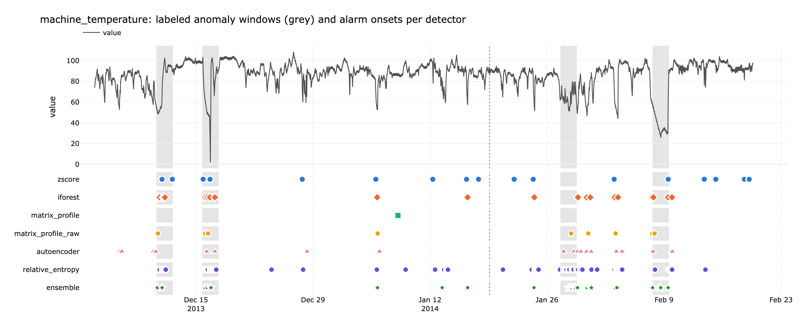
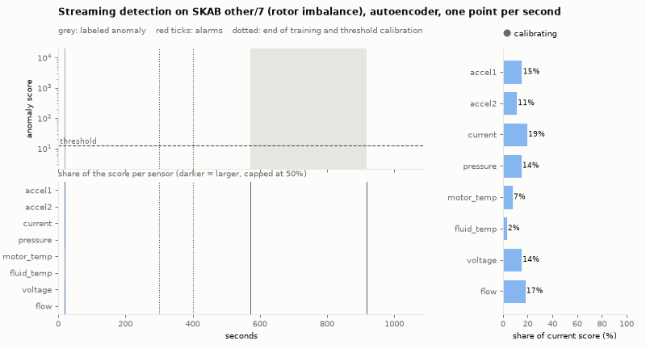

# anomaly_detection_sensor

Comparing anomaly detectors on labeled sensor time series: six univariate detectors on nine series from the
[Numenta Anomaly Benchmark](https://github.com/numenta/NAB) and three multivariate detectors with per-sensor explanations on
[SKAB](https://github.com/waico/SKAB). Evaluated at event level against a chance baseline, with a streaming variant and an
interactive threshold app.

**[Live app](https://anomalydetectionsensor-53njzwcxxrjku7qqqrjpns.streamlit.app/)**



## Univariate (NAB)

| Detector | Idea |
|---|---|
| `zscore` | deviation from trailing rolling mean (baseline) |
| `iforest` | Isolation Forest on trailing window statistics |
| `matrix_profile` | z-normalized distance to nearest normal training subsequence (stumpy AB-join) |
| `matrix_profile_raw` | same without z-normalization, sensitive to level and amplitude shifts |
| `autoencoder` | reconstruction error of a 1D-conv autoencoder trained on normal windows |
| `relative_entropy` | divergence of the current window's value histogram from recurring past ones (Wang et al. 2011) |
| `ensemble` | mean of validation-calibrated `matrix_profile_raw` and `zscore` scores at twice the context length |

- chronological split 40/20/40, labeled windows removed from training
- weekly time-of-week profile removed for series with a weekly cycle
- event-level precision, recall and F1; alarms within one context length after a window are not counted as false positives
- chance F1 and p-value from random circular shifts of each detector's alarm sequence
- five seeds for stochastic detectors, F1 over a range of threshold quantiles

## Multivariate with explanation (SKAB)

| Detector | Contribution of each sensor |
|---|---|
| `zscore` | squared standardized value |
| `pca` | complete decomposition of the combined T² + SPE index (Alcala & Qin 2011) |
| `autoencoder` | per-channel reconstruction error of a multichannel conv autoencoder |

A causal moving average (span 60 s) is subtracted from every sensor first, which removes the slow drift of the testbed.
Contributions sum to the anomaly score, so the explanation for an alarm is the share of each sensor. It is validated on faults
injected into single sensors of the anomaly-free recording and checked for plausibility against SKAB's documented fault types.

## Streaming



Every detector scores point *t* from the trailing window ending at *t*, so a fixed buffer reproduces the batch scores exactly
([src/streaming.py](src/streaming.py)). The GIF shows the multichannel autoencoder on a rotor-imbalance experiment.

## Optimization

[src/optimize.py](src/optimize.py) tunes the threshold quantile, score smoothing and a minimum alarm duration, then adds
detector subsets for ensembles, the context length and (SKAB) training on the anomaly-free recording as separate stages.
Each series is evaluated with the setting chosen on all other series, the detector included, so every reported number is a
leave-one-out estimate. A stage is adopted only if it beats the previous one with a paired bootstrap interval above zero:
on NAB the context length stage does (ensemble of `matrix_profile_raw` and `zscore` at 2× context), on SKAB none of the
extra stages helps. The adopted stages are set in [src/config.py](src/config.py).

## Holdout and external benchmarks

**Fresh NAB series** ([src/holdout.py](src/holdout.py)). All 27 remaining real NAB series with a labeled window in the test part,
run with the configuration frozen on the nine tuning series. The published NAB detectors are scored on the same test segments,
with thresholds also chosen on the tuning series only. The NAB score re-implements `nab/sweeper.py` and reproduces HTM's
published 70.10 (standard) on the full corpus.

| Pooled event F1 | tuning (9) | holdout (27) |
|---|---|---|
| contextOSE (NAB) | 0.82 | **0.63** |
| relativeEntropy (NAB) | 0.80 | 0.56 |
| HTM (NAB) | 0.77 | 0.47 |
| `autoencoder` | 0.71 | 0.39 |
| `matrix_profile_raw` | 0.68 | 0.39 |
| `ensemble` | 0.76 | 0.32 |
| chance | ~0.2 | ~0.15 |

The tuned ensemble does not transfer; the in-sample optimization overfit the nine series. Our detectors find a similar share of
events as the NAB detectors but raise two to three times as many false alarms, because they are fit once and do not adapt to
level drift.

**Improving generalization** ([src/cv.py](src/cv.py)). With the holdout used once, all 36 NAB series are evaluated by
cross-validation over the five NAB categories, the detector choice included. Of eight ideas (refractory period, rolling robust
threshold, log transform, context length from autocorrelation, robust selection rules, a relative-entropy detector, diverse
ensembles) only the **refractory period** gives a secure gain: pooled F1 0.431 → 0.466, false alarms 103 → 75. Its settings are
frozen in `results/final_config.json` and used by the app.

**Final check on the UCR Anomaly Archive** ([src/ucr.py](src/ucr.py)). The frozen settings applied unchanged to all 250 UCR
series: `matrix_profile_raw` puts its highest test score within 100 points of the anomaly in 41 % of the series, the autoencoder
in 39 % (chance 2.4 %, classic z-normalized discord search 46 %). The ranking transfers, the NAB-calibrated alarm threshold does not.

**SKAB leaderboard** ([src/skab_protocol.py](src/skab_protocol.py)). The published leaderboard predictions are re-scored with an
independent implementation of the SKAB metrics, which reproduces the leaderboard exactly. On the changepoint leaderboard the tuned
`autoencoder` reaches a NAB score of 46.0, ahead of all published models (best: MSCRED 31.9). On the point-wise outlier leaderboard
it reaches only 0.47 F1 (Conv-AE 0.78), but an always-on alarm already scores 0.70 there, so that ranking says little.

## App

[app/streamlit_app.py](app/streamlit_app.py) lets you move the threshold and see alarms, false alarms, delay and, for SKAB, the
sensor explanation update. It reads the precomputed files in `results/` and does not need torch.

## Usage

```bash
uv sync
uv run python -m src.run           # NAB
uv run python -m src.run_skab      # SKAB
uv run python -m src.animate       # docs/streaming.gif
uv run python -m src.optimize      # leave-one-out tuning
uv run python -m src.holdout       # fresh NAB series and published NAB detectors
uv run python -m src.skab_protocol # SKAB leaderboard protocol
uv run python -m src.cv            # category-wise cross-validation on 36 NAB series
uv run python -m src.ucr           # final check on the UCR Anomaly Archive (unzip into data/raw/ucr)
uv run pytest
uv run jupyter nbconvert --to html --execute notebooks/anomaly_comparison.ipynb --output-dir docs --output index.html
uv run streamlit run app/streamlit_app.py
```

Deploying the app on Streamlit Community Cloud: create an app from this repository with main file `app/streamlit_app.py`
and Python 3.12. Community Cloud uses `app/requirements.txt`, because a dependency file next to the entrypoint takes precedence
over `uv.lock` in the repository root.
